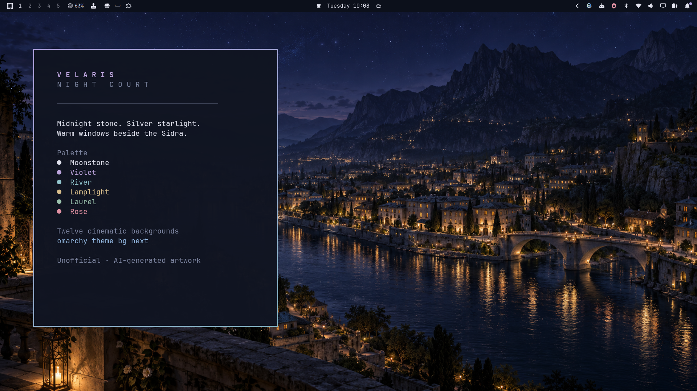

# Velaris — Night Court

A dark Omarchy theme of midnight stone, silver starlight, muted violet and warm windows. Twelve original AI-generated, cinematic fantasy wallpapers explore an imagined Velaris and its surrounding mountains, with three scenes featuring the Inner Circle.



## Install

```sh
omarchy theme install https://github.com/Cdo87/omarchy-velaris-night-court-theme
```

For a local copy, put this directory at `~/.config/omarchy/themes/velaris-night-court`, then run:

```sh
omarchy theme set velaris-night-court
omarchy theme bg next
```

The normal Omarchy theme and background pickers also work.

## The collection

| Background | Scene |
|---|---|
| 01 City of Starlight | The Sidra and warm city lights beneath immense mountains |
| 02 Sidra After Rain | Wet stone, mist and a quiet riverside promenade |
| 03 House of Wind | Red-rock cliffside residence above the valley |
| 04 Rainbow Quarter | Atelier windows, coloured plaster and lanterns |
| 05 Starfall | Separate luminous sparks crossing the night sky |
| 06 Mountain Sanctuary | A small warm cabin among pines |
| 07 Starlit Library | Firelight, books and a window over the city |
| 08 Winter in Velaris | Silver-blue snow and a partly frozen Sidra |
| 09 Rhysand & Feyre | The couple looking over the city |
| 10 Illyrian Watch | Cassian and Azriel against the mountain valley |
| 11 Courtyard Confidantes | Amren and Mor in a lantern-lit garden |
| 12 Mirror of the Night | A still mountain lake beneath three bright stars |

## Desktop treatment

`colors.toml` supplies the semantic palette. Omarchy generates its supported terminal, editor, browser, Hyprland and shell configurations. Small shell overrides coordinate the bar, notifications and lock surface. The icon colour is `Yaru-purple-dark`, as supplied by Omarchy.

This bundle contains no installation scripts or executable configurations. It does not change fonts, keybindings, window layout or idle timing. Individual applications must support Omarchy's theming mechanism to inherit the palette.

## Image quality and provenance

Wallpapers are the original **1672 × 941** PNG outputs, approximately 16:9. They are not native 1080p or 4K. On a 1920×1080 display the wallpaper renderer scales them by about 1.15×. The originals are retained without artificial detail enhancement. The preview is a separate desktop capture.

Created with OpenAI's built-in image-generation tool from original scene prompts. Three artwork revisions address Starfall's light trails and the Illyrian scene's composition. Research references informed the brief; no downloaded Instagram, calendar or video image is included in this bundle. Exact final prompts are recorded in `GENERATION.md`.

This is an **unofficial fan-inspired theme**, not an official adaptation, illustration or map. A Court of Thorns and Roses, its characters and settings originate with Sarah J. Maas. It is not affiliated with or endorsed by the author, publishers, calendar artists or referenced creators. See `LICENSE` for the scope of the licence.

## Validation

Developed against Omarchy 4.0.4-1 on a 1920×1080 laptop at 1.25 scale. The final QA report accompanying this release records the checks actually performed and the resolution limitation. Registry inclusion requires separate submission and review.
